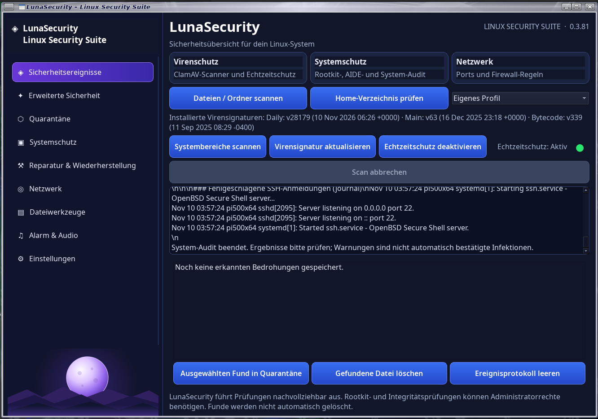

## LunaSecurity

## Version **0.4.32** · Debian 13 · Python 3 · Qt 6 / PySide6 · GTK 3
**Linux-Sicherheitswerkzeuge in einer grafischen Oberfläche**  

LunaSecurity bündelt verschiedene lokale Sicherheits- und Diagnosewerkzeuge in einer zentralen Desktop-Anwendung. Das Programm hilft dabei, Dateien zu prüfen, Sicherheitsereignisse nachzuverfolgen, ausgewählte Dateien in Quarantäne zu verschieben sowie den Zustand von System, Netzwerk und Firewall zu untersuchen.

LunaSecurity ist eine Bedienoberfläche für vorhandene Linux-Werkzeuge – kein Ersatz für ein vollständig verwaltetes Endpoint-Protection-System. Prüfungen und Schutzfunktionen haben unterschiedliche Voraussetzungen und Grenzen. Diese Dokumentation beschreibt, was die Anwendung tatsächlich ausführt und welche Schritte du selbst durchführen musst.



[Github Seite](https://github.com/Angonikro/LunaSecurity/)

## Inhalt

- [Funktionsumfang](#funktionsumfang)
- [Systemvoraussetzungen](#systemvoraussetzungen)
- [Installation](#installation)
- [Erster Start](#erster-start)
- [Bedienung](#bedienung)
- [Echtzeitschutz](#echtzeitschutz)
- [Firewall-Regeln testen und speichern](#firewall-regeln-testen-und-speichern)
- [AIDE und YARA vorbereiten](#aide-und-yara-vorbereiten)
- [Daten und Einstellungen](#daten-und-einstellungen)
- [Deinstallation](#deinstallation)
- [Sicherheitshinweise und Grenzen](#sicherheitshinweise-und-grenzen)
- [Fehlerdiagnose](#fehlerdiagnose)
- [Projektdateien](#projektdateien)

## Funktionsumfang

### Sprache und Darstellung
- Die Oberfläche bietet Deutsch und Englisch; die Auswahl wird dauerhaft gespeichert.
- Zwischen dem dunklen Graphit-Design und dem hellen Luna-Design kann ohne Neustart gewechselt werden.

### VirusTotal-Check und Upload nach Zustimmung
- Virus-Total Api eingabe unter Einstellungen möglich.

### Virenprüfung mit ClamAV

- Einzelne Dateien oder Verzeichnisse auswählen und manuell scannen.
- Das eigene Home-Verzeichnis mit einer Schnellaktion prüfen.
- Mit „Systembereiche scannen“ wichtige Systemverzeichnisse (`/etc`, `/usr/bin`, `/usr/sbin`, `/usr/lib`, `/boot`, `/opt`, `/var/lib` und `/var/log`) gezielt prüfen; virtuelle Dateisysteme wie `/proc`, `/sys` und `/dev` werden ausgelassen.
- Scanprofile steuern die Prüftiefe: „Eigenes Profil“ übernimmt exakt die Einstellungen, „Schnellscan“ reduziert Erkennungsumfang und Dateiauswahl, „Komplettscan“ aktiviert die erweiterten Optionen und höhere Größenlimits.
- Optional vor jedem Scan die ClamAV-Signaturen mit `freshclam` aktualisieren.
- Signaturen auf Knopfdruck im Hintergrund aktualisieren und installierte Datenbankversionen anzeigen.
- Scans in der Oberfläche verfolgen und – soweit vom laufenden Scan unterstützt – abbrechen.

### Optionaler ClamAV-Echtzeitschutz

- Der Echtzeitschutz kann in LunaSecurity ausdrücklich aktiviert und wieder deaktiviert werden.
- Die Einrichtung verwendet ClamAV `clamav-daemon` und `clamonacc` über den systemd-Dienst `lunasecurity-realtime.service`.
- Erkannte Ereignisse aus dem LunaSecurity-Echtzeitprotokoll können in der Anwendung angezeigt werden.
- Die ClamAV-Einstellung `OnAccessPrevention` bleibt deaktiviert: Der Echtzeitschutz meldet Erkennungen, blockiert oder löscht Dateien aber nicht automatisch.
- Der Echtzeitschutz ist nach der Installation nicht automatisch eingeschaltet.

### Sicherheitsereignisse und Quarantäne

- Erkannte Funde werden in einer lokalen Ereignisliste angezeigt.
- Eine ausgewählte erkannte Datei kann nach Bestätigung in Quarantäne verschoben oder gelöscht werden.
- Die Quarantäne zeigt ursprünglichen Pfad, SHA-256-Prüfsumme und Ablageort.
- Isolierte Dateien können manuell wiederhergestellt oder endgültig gelöscht werden.
- Quarantäneaktionen beziehen sich auf reguläre Dateien; symbolische Links werden abgewiesen.

**Wichtig:** Eine Wiederherstellung kann eine zuvor erkannte Datei wieder an ihren ursprünglichen Speicherort bringen. Stelle Dateien nur wieder her, wenn du ihre Unbedenklichkeit geprüft hast.

### Systemschutz und Integritätsprüfung

- Rootkit-Prüfung mit `rkhunter` und `chkrootkit`.
- Systemintegritätsprüfung mit AIDE.
- System-Audit mit Informationen zu aktivierten System- und Benutzerdiensten, Benutzer-Cronjobs, lokalen Konten und fehlgeschlagenen SSH-Anmeldungen im Journal.

Die Scanner werden für administrative Prüfungen einzeln über PolicyKit (`pkexec`) gestartet. Die grafische LunaSecurity-Anwendung selbst läuft nicht als Root. Während einer laufenden AIDE-Prüfung kann diese über den Abbrechen-Button neben dem Fortschrittsbalken beendet werden. Ein abgebrochener Lauf liefert ausdrücklich kein vollständiges Prüfergebnis.

### Netzwerk und Firewall

- Anzeige lokaler Listening-Sockets und zugehöriger Prozessinformationen über `ss`.
- Lesende Auswertung des lokalen nftables-Regelsatzes.
- Zusammenfassung auffälliger Listener und möglicher Firewall-Konfigurationsprobleme mit Handlungshinweisen.
- Optional können ausgewählte eingehende TCP- oder UDP-Ports nach ausdrücklicher Bestätigung über eine eigene nftables-Tabelle von LunaSecurity gesperrt werden.
- Die eigenen Sperren können temporär getestet, ausdrücklich dauerhaft gespeichert oder wieder entfernt werden.

Die reine Netzwerkprüfung verändert keine Firewall-Regeln. Die gesonderte Funktion zum Sperren eines Ports ist dagegen eine aktive Systemänderung und benötigt eine Administratorbestätigung.

### System-Tray, Startverhalten und Alarm

- LunaSecurity kann im Desktop-Infobereich (System-Tray) angezeigt werden.
- Optional bleibt das Programm beim Schließen des Fensters im Infobereich aktiv.
- Optional startet LunaSecurity bei der Desktop-Anmeldung automatisch; dieser Programm-Autostart wird benutzerspezifisch eingerichtet.
- Optional kann das Programm direkt im Infobereich starten.
- Akustische Warnungen lassen sich aktivieren, testen und mit einer eigenen WAV-Datei oder dem eingebauten Alarmton verwenden. Verfügbare Audioausgabegeräte werden – soweit vom System bereitgestellt – über die PulseAudio-kompatible Schnittstelle ermittelt.

## Systemvoraussetzungen

Die bereitgestellte Debian-Paketierung ist für Debian 13 und kompatible Debian-basierte Systeme vorgesehen. Die Anwendung verwendet:

- Python 3
- PySide6 / Qt 6 Widgets
- GTK 3 und PyGObject für das System-Tray
- systemd für die optionalen Hintergrunddienste
- PolicyKit (`pkexec`) für einzelne administrative Aktionen

Das DEB-Paket deklariert die benötigten Debian-Pakete als Abhängigkeiten. Dazu gehören ClamAV, `rkhunter`, `chkrootkit`, AIDE, YARA, nftables, iproute2, auditd sowie `lynis` und `fail2ban`. APT installiert fehlende Paketabhängigkeiten bei der Installation automatisch, sofern die Paketquellen korrekt eingerichtet sind.

Für grafische Administratorabfragen wird ein laufender PolicyKit-Authentifizierungsagent benötigt. Unter MATE wird `mate-polkit` als Empfehlung mitinstalliert. In anderen Desktopumgebungen muss der dort vorgesehene PolicyKit-Agent aktiv sein.

## Installation

### Empfohlen: Debian-Paket

Lade das passende Paket `lunasecurity_0.4.32_all.deb` herunter und installiere es im Terminal:

```bash
cd ~/Downloads
sudo apt install ./lunasecurity_0.4.32_all.deb
```

APT löst dabei die im Paket angegebenen Abhängigkeiten auf. Anschließend findest du LunaSecurity im Anwendungsmenü oder kannst es über das Terminal starten:

```bash
lunasecurity
```

### Aus dem Quellcode bauen

Das ZIP-Archiv enthält den Python-Quellcode und das Build-Skript. Zum Erstellen des Debian-Pakets werden eine Debian-Umgebung mit den benötigten Laufzeitpaketen sowie `dpkg-deb` benötigt.

```bash
unzip LunaSecurity_0.4.32_Github.zip
cd LunaSecurity
chmod +x build_deb.sh
./build_deb.sh
```

Das erzeugte Paket liegt anschließend im Verzeichnis `dist/`. Das Build-Skript legt außerdem temporäre Dateien im Verzeichnis `build/` an.

## Aus dem ZIP starten

```bash
sudo apt update
sudo apt install python3 python3-pyside6.qtwidgets python3-pyside6.qtprintsupport python3-gi gir1.2-gtk-3.0 clamav clamav-daemon clamav-freshclam rkhunter chkrootkit pkexec polkitd aide yara nftables iproute2 auditd lynis fail2ban mate-polkit
```
Lade die zip Datei runter, LunaSecurity_0.4.32_GITHUB.zip

Wechsle in den Download-Ordner und entpacke das Archiv:

```bash
cd ~/Downloads
unzip LunaSecurity_0.4.32_GITHUB.zip
```

LunaSecurity starten

Im Projektverzeichnis folgenden Befehl ausführen:

```bash
python3 -m lunasecurity
```

## Erster Start

1. Starte LunaSecurity über das Anwendungsmenü oder mit `lunasecurity`.
2. Prüfe im Hauptfenster den Status des ClamAV-Echtzeitschutzes.
3. Führe zunächst einen manuellen Scan einer ausgewählten Datei oder eines Verzeichnisses aus.
4. Aktualisiere die Virensignaturen, falls sie nicht aktuell sind.
5. Aktiviere zusätzliche Prüfungen wie Echtzeitschutz, AIDE oder YARA erst, nachdem du deren Voraussetzungen und Auswirkungen verstanden hast.

Für Rootkit-, AIDE-, Netzwerk- und Firewall-Aktionen kann eine grafische Administratorabfrage erscheinen. Erteile diese nur, wenn du die angeforderte Aktion selbst gestartet hast.

## Bedienung

### Scanprofile
- **Eigenes Profil** verwendet ausschließlich die unter Einstellungen gespeicherten ClamAV-Optionen. Deaktivierte Optionen werden nicht durch Standardwerte ergänzt.
- **Standard**, **Hoher Schutz** und **Maximaler Schutz** verwenden jeweils ihre fest definierten Scanparameter.
- Die Profilparameter gelten gleichermaßen für Home-Verzeichnis und vollständigen Systemscan. Wenn „Versteckte Dateien und Ordner untersuchen“ im eigenen Profil ausgeschaltet ist, werden versteckte Dateien und Ordner auch bei Systemscans ausgelassen.

### Virenscan

Über **Home-Verzeichnis** wird das persönliche Home-Verzeichnis geprüft; **Vollständiger Systemscan** prüft das gesamte Dateisystem `/` mit Administratorrechten. Beide Aktionen übernehmen das oben ausgewählte Scanprofil. Für ein einzelnes Ziel bleibt der zentrale Button **Scan starten** mit Datei-/Ordnerauswahl verfügbar. Die Option zur automatischen Signaturaktualisierung ist standardmäßig ausgeschaltet und kann bei Bedarf aktiviert werden.

### Sicherheitsereignisse

Im Tab **Sicherheitsereignisse** werden erkannte Funde angezeigt. Wähle einen Eintrag aus, um die zugehörige Datei nach Bestätigung in Quarantäne zu verschieben oder zu löschen. Nach erfolgreicher Aktion verschwindet genau dieser Fund aus der Ereignisliste; andere Funde bleiben erhalten. Bei einem Fehler bleibt der Eintrag sichtbar. Das Leeren des Ereignisprotokolls entfernt die gespeicherten Ereigniseinträge; es ist nicht dasselbe wie das Löschen einer Datei.

### Quarantäne

Der Tab **Quarantäne** listet isolierte Dateien. Wähle einen Eintrag aus und verwende **Wiederherstellen** oder **Endgültig löschen**. Die endgültige Löschung kann nicht rückgängig gemacht werden.

### Systemschutz

- **Rootkit-Prüfung:** startet `rkhunter` und `chkrootkit`.
- **Systemintegrität:** startet AIDE. Eine aussagekräftige Prüfung setzt eine zuvor vertrauenswürdig angelegte AIDE-Basisdatenbank voraus.
- **System-Audit:** zeigt ausgewählte Informationen zu Autostart, Diensten, Cronjobs, lokalen Konten und SSH-Journalmeldungen.

### Netzwerk

Der Netzwerk- und Firewall-Check liest die lokalen Socket- und nftables-Informationen aus. Er prüft nicht, ob ein Port von außerhalb deines Netzwerks tatsächlich erreichbar ist. Die Ergebnisansicht enthält Hinweise, die du vor einer Änderung selbst bewerten solltest.

### Infobereich und Programm-Autostart

Die drei Einstellungen haben unterschiedliche Aufgaben:

- **Beim Schließen im Infobereich weiterlaufen:** Das Fenster wird beim Schließen ausgeblendet; LunaSecurity bleibt aktiv. Zum Beenden den Beenden-Befehl im Tray-Menü verwenden.
- **Beim Start direkt im Infobereich starten:** Das Fenster wird beim Programmstart zunächst nicht eingeblendet.
- **LunaSecurity automatisch bei der Anmeldung starten:** Erstellt oder entfernt den benutzerspezifischen Desktop-Autostart-Eintrag unter `~/.config/autostart/lunasecurity.desktop`.

Dieser Programm-Autostart ist unabhängig vom systemd-Dienst für dauerhaft gespeicherte Firewall-Regeln.

## Echtzeitschutz

Der Echtzeitschutz wird über **Echtzeitschutz aktivieren** eingerichtet. LunaSecurity fordert dafür Administratorrechte an, konfiguriert die ClamAV-On-Access-Komponenten und aktiviert anschließend `lunasecurity-realtime.service`.

Status und Dienst lassen sich in der Oberfläche prüfen bzw. wieder deaktivieren. Bei Problemen helfen diese Terminalbefehle:

```bash
systemctl status clamav-daemon.service
systemctl status lunasecurity-realtime.service
sudo journalctl -u lunasecurity-realtime.service --no-pager -n 100
```

Das Echtzeitprotokoll wird unter folgendem Pfad erwartet:

```text
/var/log/clamav/lunasecurity-onaccess.log
```

Damit die grafische Anwendung dieses Protokoll lesen kann, muss der angemeldete Benutzer Mitglied der Gruppe `adm` sein. Falls erforderlich:

```bash
sudo usermod -aG adm "$USER"
```

Danach vollständig abmelden und wieder anmelden. Prüfen lässt sich die Gruppenmitgliedschaft mit:

```bash
id -nG
```

In der Ausgabe muss `adm` enthalten sein. Die Protokolldatei sollte der Gruppe `adm` gehören und Modus `640` haben. Prüfen:

```bash
stat -c '%U %G %a %n' /var/log/clamav/lunasecurity-onaccess.log
```

Falls die Ausgabe nicht `root adm 640` zeigt, kann die Berechtigung – sofern die Datei existiert – korrigiert werden:

```bash
sudo chown root:adm /var/log/clamav/lunasecurity-onaccess.log
sudo chmod 640 /var/log/clamav/lunasecurity-onaccess.log
```

Wenn ClamAV die Protokolldatei neu erstellt, sollten Eigentümer, Gruppe und Rechte erneut geprüft werden.

## Firewall-Regeln testen und speichern

Die drei Firewall-Aktionen sind in der Netzwerkseite als zweite Schaltflächenreihe direkt unter dem Netzwerk- und Firewall-Sicherheitscheck erreichbar.

Die Firewall-Funktionen befinden sich im Ergebnisdialog der Netzwerkprüfung:

1. **Port gezielt sperren …** fügt nach Eingabe von Protokoll und Port eine Regel in der separaten Tabelle `inet lunasecurity_guard` hinzu. Port 22 (SSH) ist ausgenommen.
2. Diese Regel ist zunächst temporär. Sie wird nicht automatisch als dauerhafte Regel gespeichert.
3. **Testregeln dauerhaft speichern** übernimmt die aktuellen Regeln dieser LunaSecurity-Tabelle in `/var/lib/lunasecurity/firewall-guard.nft` und aktiviert `lunasecurity-firewall-guard.service`. Der Dienst lädt die Regeln beim Systemstart nach dem nftables-Dienst.
4. **LunaSecurity-Sperren aufheben** deaktiviert diesen Firewall-Dienst, entfernt die gespeicherte LunaSecurity-Regeldatei und löscht die eigene Tabelle mit den LunaSecurity-Sperren.

Vor dem Speichern wird der vorhandene nftables-Regelsatz nach `/var/lib/lunasecurity/` gesichert. Diese Sicherung ist eine Datei zur manuellen Wiederherstellung und wird durch das Aufheben der LunaSecurity-Sperren nicht automatisch zurückgespielt.

**Achtung:** Eine Port-Sperre kann Netzwerkdienste unerreichbar machen. Prüfe Protokoll und Port sorgfältig. Führe Firewall-Änderungen möglichst mit lokalem Zugriff auf das Gerät durch und halte bei Fernwartung eine zweite funktionierende Sitzung offen. Die Anwendung verändert beim Aufheben nur ihre eigene Tabelle; andere Firewall-Regeln sollen unangetastet bleiben.

## AIDE und YARA vorbereiten

**Wichtig für AIDE:** Die Installation des Pakets allein erstellt noch keine vertrauenswürdige Referenzdatenbank. Führe `sudo aideinit` erst aus, wenn du den Systemzustand geprüft hast. Ohne initialisierte und aktivierte Datenbank kann die Integritätsprüfung nicht sinnvoll vergleichen.

### AIDE

LunaSecurity startet für die AIDE-Prüfung ausschließlich einen kleinen, dedizierten Hilfsprozess über `pkexec`. Dadurch erscheint die grafische Administratorabfrage und nur der AIDE-Prüfvorgang läuft mit Root-Rechten; die LunaSecurity-Oberfläche selbst bleibt unprivilegiert. Der Hilfsprozess verwendet unter Debian `aide.wrapper --check` und damit die von Debian verwaltete AIDE-Konfiguration. Falls noch keine Referenzdatenbank existiert, muss diese nach Prüfung des sauberen Systemzustands einmalig mit `sudo aideinit` initialisiert und anschließend gemäß den Hinweisen der installierten Debian-AIDE-Version aktiviert werden. Eine fehlende Datenbank ist kein Integritätsfund und bedeutet, dass noch kein aussagekräftiger Soll-Ist-Vergleich möglich ist.


AIDE vergleicht das System mit einer Referenzdatenbank. Eine solche Datenbank muss zuerst auf einem vertrauenswürdigen, möglichst sauberen Systemzustand erstellt und geprüft werden. Debian stellt dafür üblicherweise `aideinit` bereit. LunaSecurity initialisiert diese Datenbank nicht automatisch.

Einmalige Initialisierung der AIDE-Referenzdatenbank:

```bash
sudo aideinit
```

Folge anschließend den Hinweisen deiner Debian-Version zur Übernahme der erzeugten Datenbank. Eine ungeprüfte oder bereits kompromittierte Ausgangsdatenbank ist keine vertrauenswürdige Referenz.

### YARA

LunaSecurity führt keine YARA-Regeln aus dem Internet automatisch ein. Lege selbst geprüfte `.yar`- oder `.yara`-Regeldateien in diesem Verzeichnis ab:

```text
/etc/lunasecurity/yara-rules/
```

Ohne passende Regeldateien kann YARA keine Signaturtreffer liefern. Die Qualität der Ergebnisse hängt vollständig von den verwendeten Regeln ab.

## Daten und Einstellungen

LunaSecurity speichert benutzerspezifische Daten getrennt von den Systemdiensten:

| Pfad | Inhalt |
|---|---|
| `~/.config/` (Qt-Settings für LunaSecurity) | Programmoptionen wie Tray-Verhalten und Scan-/Audioeinstellungen |
| `~/.config/autostart/lunasecurity.desktop` | Optionaler Start bei der Desktop-Anmeldung |
| `~/.local/share/LunaSecurity/security-events.json` | Lokales Sicherheitsereignis-Protokoll (maximal 200 Einträge) |
| `~/.local/share/LunaSecurity/security.db` | SQLite-Inventar der Quarantäne |
| `~/.local/share/LunaSecurity/quarantine/` | Isolierte Dateien |
| `/var/lib/lunasecurity/` | Firewall-Sicherungen und gegebenenfalls dauerhaft gespeicherte LunaSecurity-Regeln |
| `/var/log/clamav/lunasecurity-onaccess.log` | Protokoll des optionalen ClamAV-Echtzeitschutzes |

Die konkreten Speicherorte im Home-Verzeichnis gehören jeweils dem angemeldeten Benutzer. Sichere wichtige Quarantäne- oder Ereignisdaten bei Bedarf separat, bevor du Benutzerdateien löschst oder das System neu installierst.

## Deinstallation

Das Programm kann mit APT entfernt werden:

```bash
sudo apt remove lunasecurity
```

Dabei bleiben benutzerspezifische Einstellungen und Daten sowie möglicherweise angelegte Firewall-Zustandsdateien erhalten. Prüfe vor dem Entfernen in LunaSecurity, ob du aktive oder dauerhaft gespeicherte LunaSecurity-Firewall-Sperren aufheben möchtest.

Wenn du auch die Paket-Konfigurationsreste entfernen möchtest:

```bash
sudo apt purge lunasecurity
```

`purge` entfernt Paket-Konfigurationsdateien, aber nicht automatisch alle oben aufgeführten benutzerspezifischen Daten oder Firewall-Sicherungen. Diese kannst du nach eigener Prüfung manuell löschen. Entferne `/var/lib/lunasecurity/` nicht, solange du dort noch benötigte Firewall-Sicherungen aufbewahren möchtest.

## Sicherheitshinweise und Grenzen

- LunaSecurity ist ein lokales Hilfsprogramm und keine Garantie für ein schadsoftwarefreies System.
- Ein unauffälliger Scan schließt unbekannte oder nicht erkannte Schadsoftware nicht aus.
- Rootkit-Scanner und Signaturregeln können Fehlalarme oder übersehene Funde liefern.
- AIDE ist nur so zuverlässig wie die vertrauenswürdige Referenzdatenbank.
- YARA benötigt geeignete, aktuelle und vertrauenswürdige Regeln.
- Die Netzwerkprüfung untersucht lokale Informationen. Router, Provider-Firewalls und externe Erreichbarkeit werden nicht geprüft.
- Der ClamAV-Echtzeitschutz meldet Funde, blockiert oder löscht sie in dieser Konfiguration aber nicht automatisch.
- Die Quarantäne ist eine manuell bediente Dateiaktion und keine automatische Überwachung aller Downloads oder USB-Datenträger.
- Firewall-Sperren sind aktive Eingriffe in die Netzwerkkonfiguration. Prüfe jede Aktion und halte einen Wiederherstellungsweg bereit.

## Fehlerdiagnose

### Programm startet nicht

Starte LunaSecurity im Terminal, damit Fehlermeldungen sichtbar werden:

```bash
lunasecurity
```

Prüfe außerdem, ob die Paketdateien und Abhängigkeiten korrekt installiert sind:

```bash
dpkg -s lunasecurity
sudo apt --fix-broken install
```

### Administratorabfrage erscheint nicht

Prüfe, ob `pkexec` vorhanden ist und ein PolicyKit-Agent in deiner Desktop-Sitzung läuft:

```bash
command -v pkexec
```

Unter MATE kann `mate-polkit` verwendet werden. Andere Desktopumgebungen benötigen ihren jeweils passenden Authentifizierungsagenten.

### ClamAV-Signaturen sind nicht aktuell

```bash
sudo systemctl status clamav-freshclam.service
sudo journalctl -u clamav-freshclam.service --no-pager -n 80
```

### Echtzeitschutz läuft nicht

```bash
sudo systemctl status clamav-daemon.service lunasecurity-realtime.service
sudo journalctl -u lunasecurity-realtime.service --no-pager -n 100
```

### Firewall-Regeln kontrollieren

```bash
sudo nft list ruleset
sudo systemctl status lunasecurity-firewall-guard.service
```

Führe keine pauschalen Lösch- oder Reset-Befehle für nftables aus, wenn andere Anwendungen oder Dienste eigene Firewall-Regeln verwalten.

## Projektdateien

- `lunasecurity/` – Python-Anwendung und Sicherheitsmodule
- `scripts/` – Hilfsprogramme und systemd-Diensteinheiten
- `debian/` – Desktop-Integration
- `assets/` – Programmsymbol
- `build_deb.sh` – Erstellung des Debian-Pakets
- `CHANGELOG.md` – chronologische Liste der Änderungen je Version

Fehlerberichte sollten die LunaSecurity-Version, Debian-Version, den verwendeten Desktop und die vollständige Terminal- oder Journal-Fehlermeldung enthalten. Bitte entferne vorher persönliche Pfade, Benutzernamen oder andere private Angaben.

## Lizenz und Verantwortung

Dieses Projekt wird ohne Garantie bereitgestellt. Prüfe sicherheitsrelevante Änderungen vor dem Einsatz und bewahre bei Systemänderungen eine Möglichkeit zur Wiederherstellung.

73 de DO2QG Andraes
